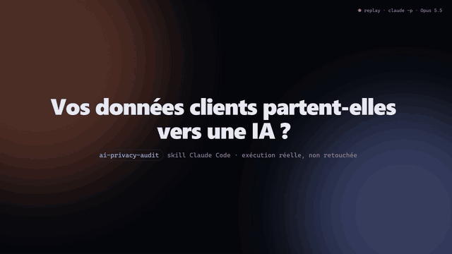

# ai-privacy-audit

Claude Code skill that audits a codebase for personal-data risks around AI.



▶ [HD version (MP4)](demo/demo.mp4). This is a replay of a real, unedited `claude -p` run: the tool calls, their timestamps and the report all come from [`demo/trace.json`](demo/trace.json). The animation is built with Framer Motion ([`demo/scene.html`](demo/scene.html)) and rendered frame by frame ([`demo/render.py`](demo/render.py)).

## What it checks

- personal data (PII) sent to LLM APIs (OpenAI, Anthropic, Mistral, Gemini, Bedrock, Ollama…)
- prompt injection, weighted by what the model can actually do (tools, SQL, HTML rendering)
- RAG / vector search without per-user or per-tenant access control
- prompts and responses written to logs, observability tools or long-lived storage
- AI API keys hardcoded, committed or exposed to the browser

The skill traces each prompt back to where its data comes from. It reports verified `file:line` findings, each with a severity, a scenario and a fix. It never copies secret values and never modifies code. Reports are written in the user's language.

## Install

```bash
git clone https://github.com/OutOfAmine/ai-privacy-audit
cp -r ai-privacy-audit/skills/ai-privacy-audit ~/.claude/skills/
```

Then in Claude Code, ask *"audit my project for personal data leaking to AI"*, or run `/ai-privacy-audit`.

## Example

[`examples/fixture-app`](examples/fixture-app) is a small app with deliberate flaws. [`examples/fixture-app-report.md`](examples/fixture-app-report.md) is the report from the run shown in the video. The run took 45 s and used 5 read-only tool calls. It produced 7 findings (4 critical, 2 high, 1 medium) and correctly skipped the safe file. Severity and grouping can vary slightly between runs.

The key in the fixture is a placeholder, not a real key.

## License

MIT
